# Poolgob

### Liquidity leaves a trail.

A quiet observer for Solana's small, fast-moving token pools. Poolgob follows depth, concentration and the shape of an exit, then keeps the evidence in a persistent research file.

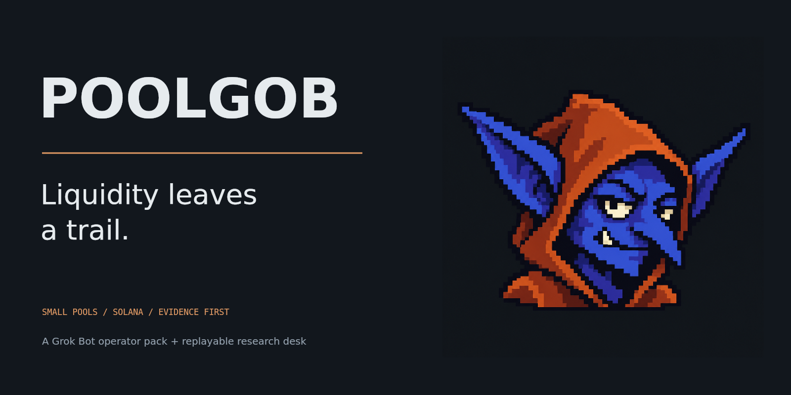

**One goblin. One watchlist. A record of what changed.**

The project pairs a runnable local liquidity replay with a **Grok Bot operator pack**. The replay produces inspectable pool observations, modeled exits and source-linked findings. The operator instructions turn those files into a repeatable research workflow in the user's own Grok Bot account.

Poolgob is designed for the part of Solana where attention arrives quickly and liquidity can be thin: small community tokens, unusual tickers and meme-native assets. The emphasis is on the pool beneath the story.

| Release | Research views | Reference data | Execution |
|---|---|---|---|
| 0.1.0 | 12 distinct views | 8 fictional pools; up to 40 observations each | Local replay and file-based Grok Bot handoff |

[Start here](QUICKSTART.md) · [Pool mathematics](AMM-MODEL.md) · [Grok Bot setup](GROKBOT-README.md) · [Screenshot atlas](SCREENSHOTS.md) · [Upload guide](GITHUB-UPLOAD.md)

## The question behind Poolgob

**What can actually leave this pool, at this size, under these assumptions?**

A displayed balance, an active chart and a widely repeated story answer different questions. Poolgob starts with a pool snapshot and a declared ticket size, then follows the details that make an observation useful:

- How much SOL is in the modeled quote reserve?
- Did a tagged liquidity event occur, or did a swap merely change the reserve?
- How does a larger exit behave when the same pool becomes thinner?
- Which balances belong in a concentration denominator?
- Is the observation fresh enough to support an estimate?
- Can another reader inspect the source bytes behind the note?

The shipped dataset is a seeded synthetic replay. Every figure below is rendered from that data and the application code. Pool labels, wallet aliases and relative timestamps are fictional. The local engine is a transparent constant-product abstraction; it is not a live route or a deployed exchange adapter.

## Open the desk

**No-install route:** extract the repository and open **`Poolgob.html`**. It embeds the data, code, styles and original mascot.

**Source route:** use Node.js 20 or newer, open a terminal in this folder, and run:

```sh
npm start
```

Open `http://127.0.0.1:4173`. Use the server for `index.html`; use `Poolgob.html` for the self-contained offline edition. There are no runtime packages to install.

Choose a pool, change the nominal SOL ticket, move the replay clock, and switch among twelve views. Export a case, a receipt, a CSV or the current figure. A stale pool remains visible while its quote is withheld.

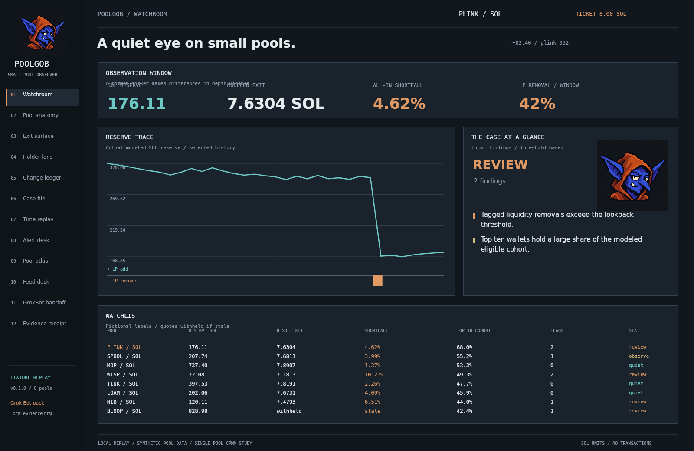

## Read the reserves before the narrative

Poolgob separates four things that are often blurred together: reserve balances, reserve ratio, swap notional and tagged LP activity.

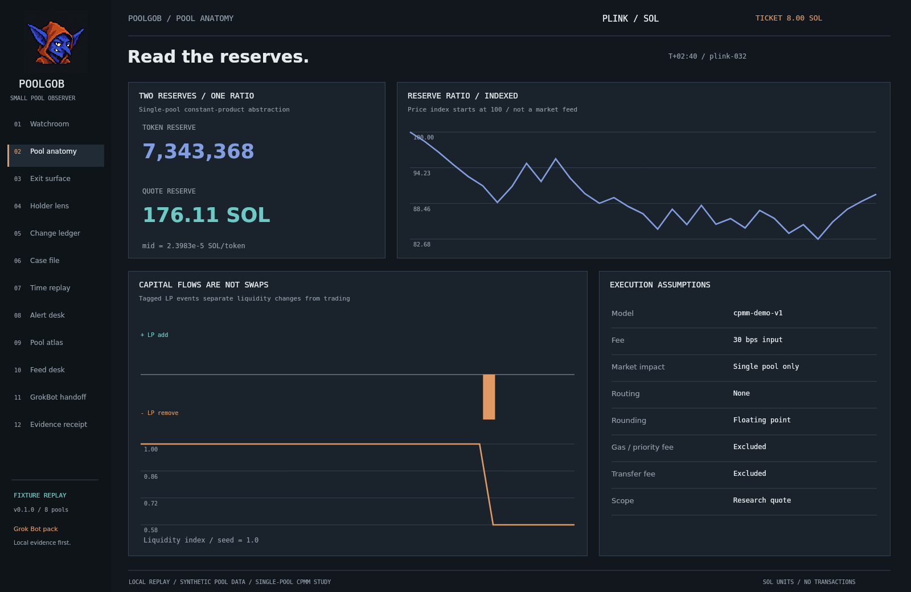

The local model has a token reserve `x` and a SOL reserve `y`. Its pre-quote mid is `y / x`. An input fee is applied once, the effective token input moves along the constant-product curve, and the full token input remains in the reserve.

The anatomy view keeps the assumptions beside the chart: single pool, declared fee, floating-point arithmetic, no route search, no gas estimate and no transfer-fee accounting. These are model boundaries, not hidden defaults.

## The exit surface

Each row is a token position marked at the starting mid. Each column proportionally scales down both reserves while preserving that starting price ratio. The position stays fixed across the row. A thinner pool can produce less SOL even when its quoted mid has not changed.

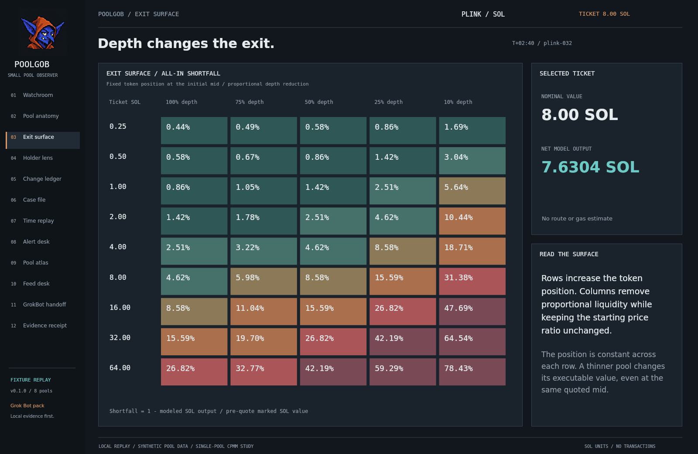

The heatmap displays **all-in quote shortfall** relative to the pre-quote marked value. It includes the modeled input fee and the curve effect. It is not a prediction of future price, a slippage-tolerance setting or an estimate of a real transaction's final fill.

For the default PLINK observation:

| Input or result | Value |
|---|---:|
| Nominal ticket | 8.00 SOL |
| Quote reserve | 176.11 SOL |
| Modeled output | 7.6304 SOL |
| All-in shortfall | 4.62% |
| Tagged removals in the lookback | 42% |

The values are computed, not pasted into the screenshots. See [the generated surface](plink-surface.json) and [the equations](AMM-MODEL.md).

## Concentration needs a denominator

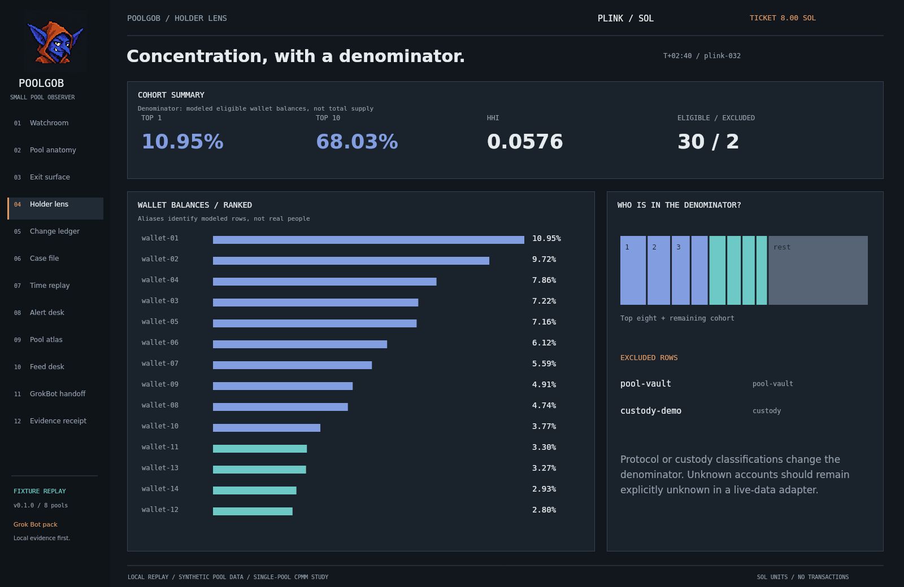

The reference replay includes 30 eligible wallet aliases and two excluded rows per observation. Top-one, top-ten and HHI measurements refer to the **modeled eligible wallet cohort**, not total token supply. Pool-vault and custody classifications are visible.

A token account is not automatically a unique person or an independent wallet owner. A future live-data adapter must preserve that distinction and state its coverage. Poolgob's fixture aliases do not imply real identities or ownership clusters. [Concentration methods](CONCENTRATION.md) explain the scope.

## Every change has a trail

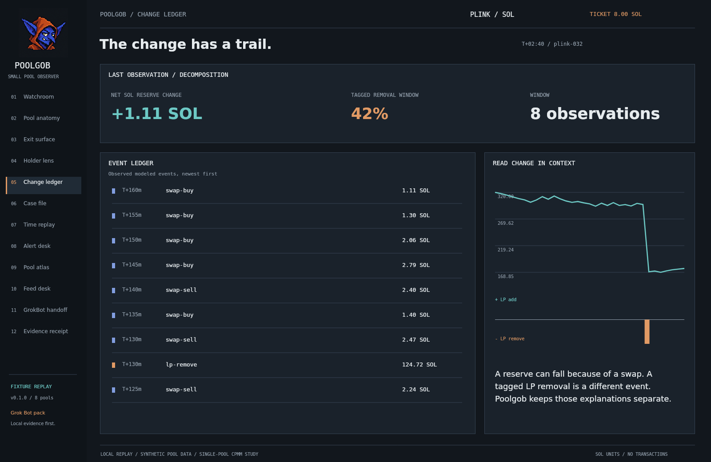

An outgoing SOL reserve movement alone does not establish an LP withdrawal. In this replay, LP removals are known because the generator records their event type and fraction. Poolgob retains that event and the snapshot ID rather than inferring a story from the direction of a line.

The default lookback is eight observations. Multiple tagged removal fractions combine multiplicatively; the finding reports gross tagged removal effects in the window, not a reconstructed net LP ownership statement.

## Findings with source references

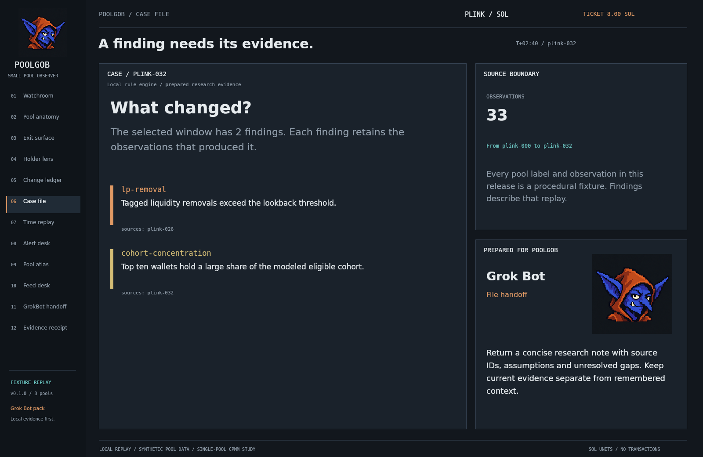

Four transparent rules produce local findings:

| Rule | Default condition | Behavior |
|---|---|---|
| Tagged LP removal | At least 15% across the lookback | Review finding |
| Cohort concentration | Top ten above 55% | Observation finding |
| Exit friction | All-in modeled shortfall above 5% | Review finding |
| Freshness | More than one simulated tick old | Review finding; quote withheld |

`quiet`, `observe` and `review` are research-queue states. A quiet state means no configured threshold fired; it does not rate a token's safety or recommend a trade. [Rule definitions](ALERTS.md) include boundary conditions.

## Replay without borrowing the future

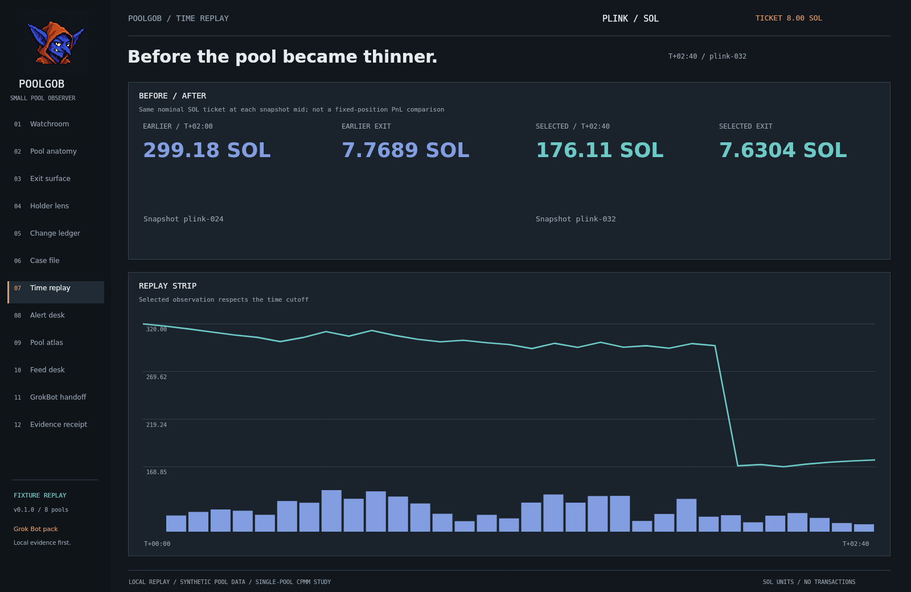

Analysis only sees snapshots at or before the selected tick. The time-replay comparison sizes a new nominal SOL ticket at each snapshot's own mid. That is a depth comparison, not the PnL of a fixed historical token position.

The exit surface uses a different comparison: it holds the token position constant across depth reductions at one snapshot. Both are useful when their definitions stay visible. See [replay methods](REPLAY.md).

## One watchlist, explicit thresholds

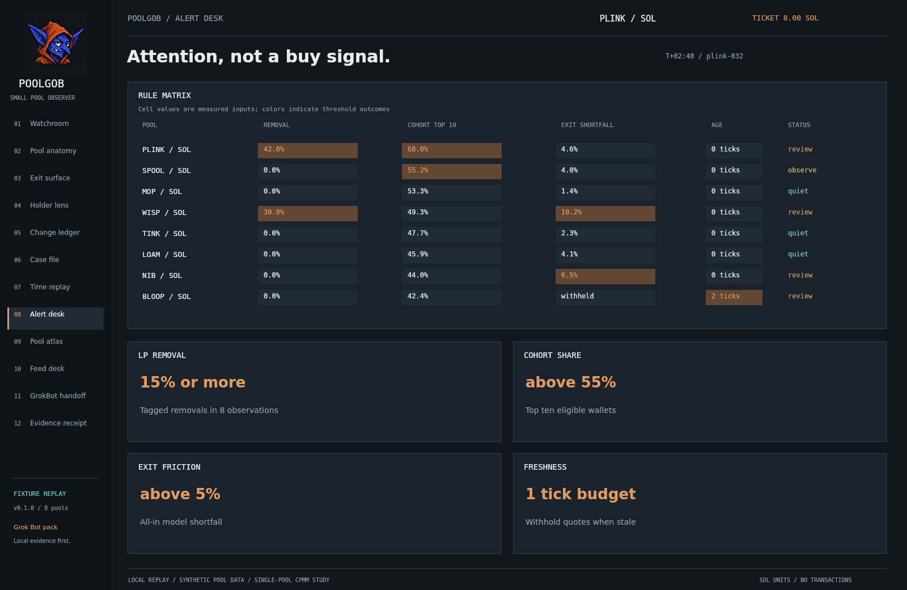

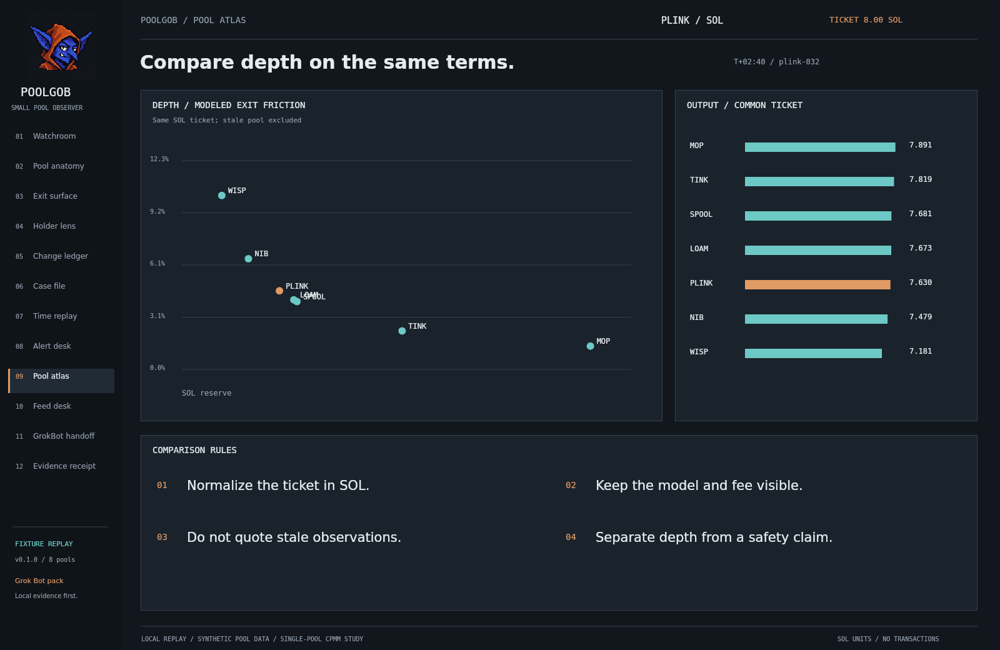

The atlas compares pools using the same input convention and fee model. Stale observations are excluded from exit estimates. Large reserves, low concentration or a small modeled shortfall are individual measurements, not a combined promise of market quality.

## Freshness is part of the output

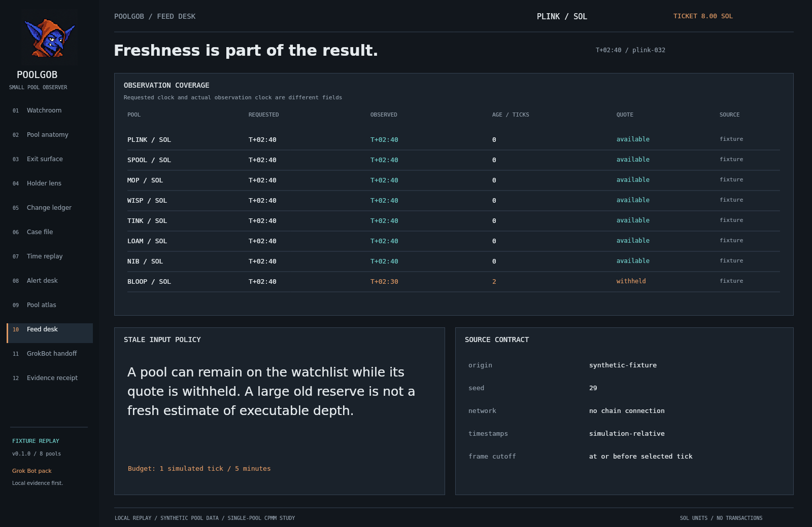

The BLOOP fixture stops providing observations after tick 30. At the default requested tick 32, it is outside the one-tick freshness budget. Poolgob shows the old observation and withholds its quote and exit surface.

This is intentional missing-data behavior. A local research tool should retain the gap rather than make the old snapshot look current.

## Poolgob as a Grok Bot

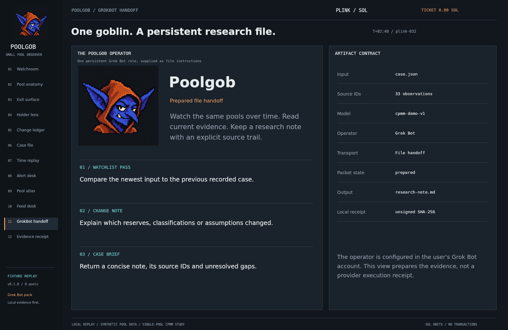

The integration supplies **one persistent operator identity**. Poolgob keeps the same watchlist and research preferences, reads a current case packet, compares it with earlier notes and returns a source-bounded research note.

The pack contains:

- [Operator instructions](GROKBOT-OPERATOR.md) for a named Poolgob Bot.
- [A watchlist routine](GROKBOT-WATCHLIST-ROUTINE.md) to configure after a successful manual pass.
- [A case-brief instruction](GROKBOT-CASE-BRIEF.md) for an attributed research note.
- [Setup and artifact contracts](GROKBOT-README.md), including how to distinguish prepared files from completed provider work.

The connection model is **user-managed file handoff** in the user's Grok Bot account. Local calculations produce evidence; the configured Grok Bot reads those artifacts and follows the supplied role. The repository manifest describes Poolgob's own pack, not an official SDK or automatic account installer.

Product documentation was checked on 29 October 2026. Official references and the scope of the integration are recorded in [source notes](SOURCES.md).

## Keep the evidence bytes

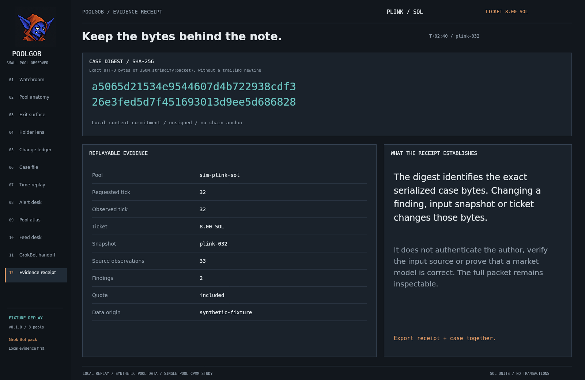

Each local receipt includes the full case and a SHA-256 digest of the exact UTF-8 bytes of `JSON.stringify(packet)`, without a trailing newline. The encoding is explicit and order-sensitive; it is not a general canonical-JSON scheme.

```sh
node verify-case.mjs plink-receipt.json
```

The digest detects a change to the serialized case. It does not authenticate an author, verify an external source, establish correctness of the model or create a blockchain anchor. The full packet remains inspectable.

## Reproduce the research desk

```sh
npm run demo
npm run data
npm run build
npm test
npm run check
```

The source targets Node.js 20+. The prepared package was tested on Node.js 24.22.1. Runtime, test, data and build commands use the standard library. PNG regeneration additionally needs an optional native Canvas renderer and local DejaVu fonts; see [reproducibility](REPRODUCIBILITY.md).

All twelve images are application-generated research views, rendered directly from the same drawing functions and data used by the local interface. They are not browser screenshots or images of Grok Bot's own application. The mascot is separately generated original artwork; it does not encode market data. [Art provenance](PROVENANCE.md) records its prompt and source.

## Repository map

This edition keeps every file in one directory. The logo, cover and all twelve screenshots sit beside this README, so a single file selection includes the complete project.

| Location | Contents |
|---|---|
| `core-*.mjs` | Seeded fixture, idealized AMM, cohort metrics, findings and receipts |
| `view-*.mjs`, `view-style.css` | Twelve research compositions, controls and exports |
| `watchlist.json` | Reproducible fictional watchlist |
| `plink-*.json` | Full case, receipt and exit-surface output |
| `study-*.json`, `STUDY-RESULTS.md` | Depth, freshness and cohort sensitivity studies |
| `GROKBOT-*.md`, `GROKBOT-pack.json` | One operator role and repeatable workflow instructions |
| `build.mjs`, `capture.mjs`, `check.mjs` and other root scripts | Build, replay, capture, study and integrity tooling |
| `test-*.test.mjs` | Mathematical invariants, source boundaries, freshness and interface wiring |
| Uppercase Markdown files | Methods, assumptions, setup and upload guidance |
| `poolgob.png`, `poolgob-cover.png`, `01-*.png` through `12-*.png` | Original pixel character, cover and twelve research figures |

`github-check.yml` and the issue/pull-request Markdown files are optional GitHub templates. Local commands work from this flat directory. The workflow template runs on GitHub only if later installed at `.github/workflows/check.yml`.

## What this release establishes

Poolgob provides a working local research replay and a documented Grok Bot operator pack. It supplies no wallet, transaction signing, live pool feed, deployed Solana program or automated order execution. Concentrated-liquidity pools, transfer-fee tokens, routing, token-program extensions and integer execution arithmetic require model-specific adapters.

Next work includes timestamped external fixtures, account classification evidence, independent provider comparisons and an authenticated transport with real execution receipts. [Roadmap](ROADMAP.md) and [limitations](LIMITATIONS.md) define that boundary.

---

Original Poolgob identity and code. [MIT license](LICENSE). [Upload this project](GITHUB-UPLOAD.md) to the GitHub account you choose.
